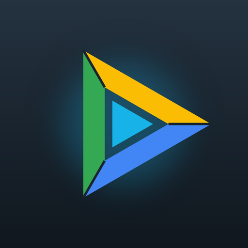

# GDrive Bridge

A Kodi add-on that serves your **Google Drive** to Kodi as a read-only **WebDAV source** on the
same device. Add `dav://127.0.0.1:8765/` as a video source and Kodi browses, scans and plays your
Drive like any network share, with seeking and subtitles.

- **My Drive**, **Shared with me**, **Shared drives** and **Starred**, kept current from Drive's
  change feed.
- **Search** (add-on menu → *Search Google Drive*): matching files and folders open as a folder
  you can browse and play.
- **Several Google accounts**: each extra account is one more top-level folder.
- **Videos and pictures**: add the same source under Pictures for photos and slideshows. iPhone
  **HEIC** photos (which Kodi can't display) are shown as JPEGs made by Google.
- **Kodi's library** reads `.nfo` files, posters/fanart and subtitles stored next to your videos,
  exactly as from any network share.
- **Set up from any phone, tablet or computer**: the add-on shows a QR code (or an address and PIN)
  for its setup page, which walks you through everything, including creating your Google client.
- **Your own Google client.** Sign-in goes straight between your device and Google; nothing passes
  through anyone else's server.
- **Read-only** (`drive.readonly`). It never changes or deletes anything in your Drive.

Tested on Kodi 21 (Omega) on an NVIDIA Shield (Android TV). It needs Kodi 20 or later.

## Install

1. Download `service.gdrivebridge-<version>.zip` from
   [Releases](https://github.com/GDrive-Bridge/gdrive-bridge/releases/latest).
2. In Kodi: **Settings > System > Add-ons**, turn on **Unknown sources**.
3. **Settings > Add-ons > Install from zip file**, choose the zip.

## Set up

1. Open **Add-ons > GDrive Bridge > Set up on phone or computer**.
2. Scan the QR code with your phone (or open the address shown and enter the PIN).
3. Follow **Step 1** on the setup page to create your own Google Cloud client (about 10 minutes,
   once): a **Web application** client with the redirect URI
   `https://gdrive-bridge.github.io/gdrive-bridge/callback.html`. Paste the downloaded JSON
   file into the page.
4. **Step 2: Sign in with Google.** After you allow access, Google returns your phone to the
   relay page above, which hands the sign-in straight to the setup page on your Kodi device
   (your phone must be on the same network). Nothing to copy, and the relay is a static page:
   it never sees your client secret or your sign-in, which are exchanged with Google by your
   Kodi device itself.

   With a **Desktop app** client instead, your phone ends on a page that "can't be reached"
   (`127.0.0.1`); copy its address back into the setup page.
5. In Kodi: **Videos > Files > Add videos > Browse > Add network location**: protocol
   **WebDAV server (HTTP)**, server **127.0.0.1**, port **8765**. Pick a folder, name it, and set
   the content type for folders that hold films or TV shows.

### Signing in every 7 days

While your Google app is in *Testing*, Google ends the sign-in after 7 days. Kodi shows a
notification; sign in again from the setup page. To stop this, **publish** your app (optional
last step in the setup guide). Google's verification isn't needed for your own use. Publishing
asks for a home page and privacy policy; you can use this project's:

- Application home page: `https://gdrive-bridge.github.io/gdrive-bridge/`
- Privacy policy: `https://gdrive-bridge.github.io/gdrive-bridge/privacy.html`
- Authorised domain: `gdrive-bridge.github.io`

Google then shows *"Your branding is not being shown to users"* (the pages aren't on your own
domain) and *"Your app requires verification"*. Both are expected and don't stop you publishing;
verification only matters for apps with more than 100 users. Sign-in shows an *unverified app*
warning instead: choose **Advanced > Go to … (unsafe)**.

Then sign in once more (sign-ins made while testing keep the 7-day limit).

## Several accounts

On the setup page, under **More Google accounts**, choose **Add another Google account** and sign
in with it (while your Google app is in *Testing*, add that account as a test user first). It
appears in Kodi as a folder named after the account, next to *My Drive*, with its own *My
Drive*, *Shared with me*, *Shared drives* and *Starred*. Rename or remove it on the same page.

## Settings

All settings are on the setup page and in Kodi's add-on settings:

| Setting | Default | |
|---|---|---|
| Show *Shared with me* / *Shared drives* / *Starred* | on | Top-level folders. Don't give the top level a content type: starred items would be scanned twice |
| Show iPhone HEIC photos as JPEG | on | Uses Google's JPEG rendering (up to 3840 px) |
| Hide files and folders starting with a dot | on | `.git`… |
| Hide archives (.zip, .rar, .7z, .apk…) | on | See below |
| Check Drive for changes every | 60 s | |
| WebDAV port | 8765 | Update your Kodi source if you change it |
| Share Drive with other devices on my network | off | Basic-auth WebDAV for another Kodi |
| Setup page | opens when you choose *Set up on phone or computer* in Kodi and closes after 15 minutes idle; can be set to always on (port 8766) | PIN or one-time QR link needed |

**Why archives are hidden:** Kodi treats `.zip`/`.rar`/`.apk` files as folders and opens them to
look inside, on its screen thread, when it lists a folder. Over Google Drive each read is a
separate download, so a folder containing an archive froze Kodi on "Content Loading" for tens of
seconds. Kodi can't play archives anyway.

**Why folders are read ahead:** on Kodi 21 (Android) we saw that while Kodi's screen waits on
a slow folder, all of Kodi's Python add-ons can freeze until Kodi gives up after 20 seconds. So
GDrive Bridge answers from its cache wherever it can: it lists the subfolders of whatever Kodi
opens in the background, serves older copies at once while refreshing them, and *Search* runs
before its window opens. Only a folder that has never been listed makes Kodi wait.

## Privacy

See the [privacy policy](https://gdrive-bridge.github.io/gdrive-bridge/privacy.html). In short:
everything stays on your device and is exchanged only with Google.

## Development

- `service.gdrivebridge/` is the add-on. `python3 tools/build_zip.py` builds the release zip.
- Tests (standard library only): `python3 tools/test_local.py` and `python3 tools/test_drive.py`.
- `tools/make_icon.py` (needs Pillow) draws the icon and fanart.
- `docs/` is the GitHub Pages site (home page, privacy policy, optional sign-in relay page).

## Licence

MIT. See [LICENSE](LICENSE).
